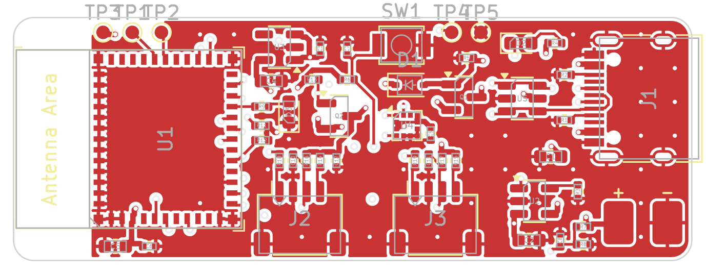
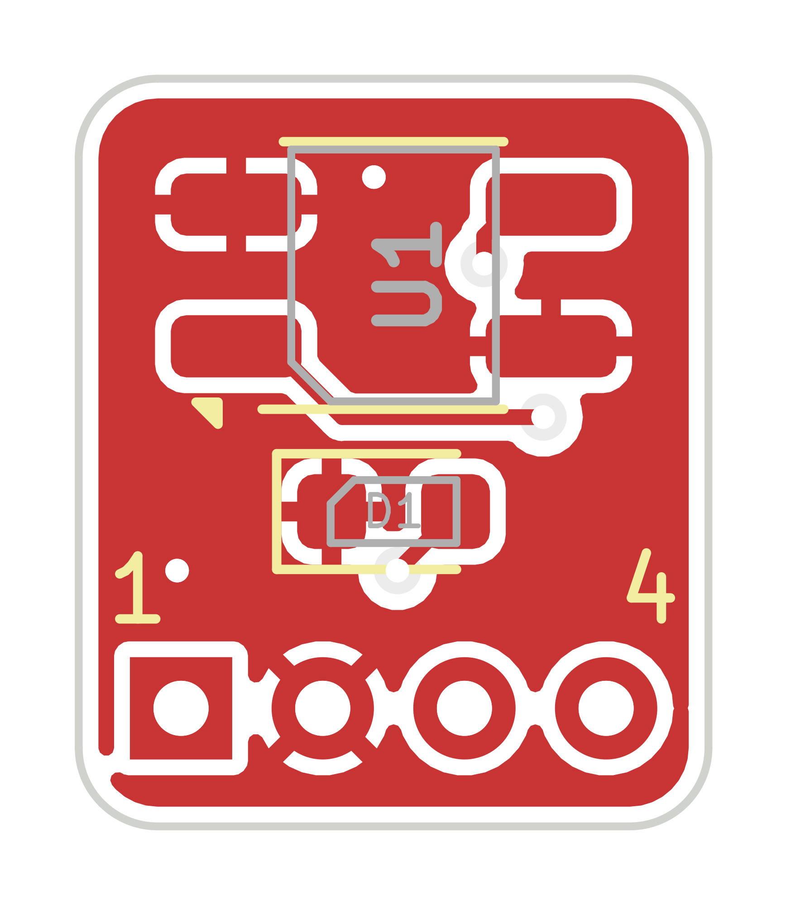
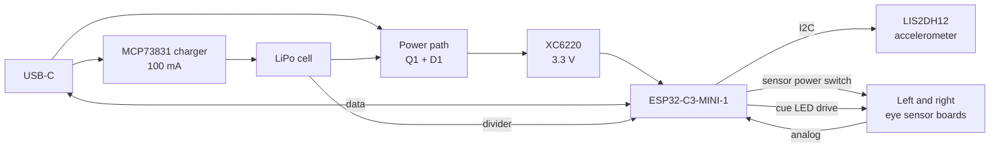

# DreamCatcher hardware

Two small boards that replace the ESP32 dev board and the QTR-1A breakout in the mask:

| Board | Size | What's on it |
| --- | --- | --- |
| [Main board](dreamcatcher-main) | 50 x 18 mm, 4 layers, parts on one side | ESP32-C3 module, USB-C charging and flashing, LiPo charger, 3.3 V regulator, accelerometer, two eye sensor connectors |
| [Eye sensor board](dreamcatcher-eye-sensor) (one per eye) | 8 x 9.5 mm, 2 layers | IR reflectance sensor and a red cue LED |

The main board sits on the forehead or temple. Each eye sensor board sits in front of an
eye and connects to the main board with a thin four-wire cable, so nothing bulky
presses on the eye.





**This design has not been built yet.** The connections and design rules are checked
by script (see [What has been checked](#what-has-been-checked)), but no board has been
manufactured or powered. Read [Before you order](#before-you-order) first.

## How it works



- **Eye sensors.** Each eye board carries a QRE1113GR, the same sensor as on the QTR-1A
  you use now, wired the same way: a 220 Ω resistor for the IR LED and a 47 kΩ pull-up
  on the phototransistor. Those resistors are on the main board, so the eye board holds
  only the sensor and the cue LED. Q2 switches power to both sensors, so they draw
  nothing between readings.
- **Accelerometer.** A LIS2DH12 detects head and body movement directly, instead of
  inferring it from the IR signal. Its interrupt pin can wake the chip from deep sleep.
- **Power.** USB-C charges the cell at 100 mA. On USB the board runs from USB and the
  cell only charges (Q1 and D1), so charging finishes properly. The regulator draws
  about 8 µA itself.
- **USB.** The ESP32-C3's built-in USB serial/JTAG is wired to the connector, so the
  board is flashed over USB-C with no extra chip.

### Pin map

| ESP32-C3 pin | Net | Use |
| --- | --- | --- |
| GPIO0 (ADC1_CH0) | `EYE_L_OUT` | Left eye sensor reading |
| GPIO1 (ADC1_CH1) | `EYE_R_OUT` | Right eye sensor reading |
| GPIO2 | `SENS_EN_N` | Eye sensor power, **low = on** |
| GPIO3 (ADC1_CH3) | `VBAT_SENSE` | Battery voltage / 2 |
| GPIO4 | `ACC_INT1` | Accelerometer interrupt (can wake from deep sleep) |
| GPIO5 | `CUE_L` | Left cue LED, high = on |
| GPIO6 | `CUE_R` | Right cue LED, high = on |
| GPIO7 | `LED_STAT` | Green status LED on the main board, high = on |
| GPIO8 | `I2C_SDA` | Accelerometer (address 0x19) |
| GPIO10 | `I2C_SCL` | Accelerometer |
| GPIO9 | `BOOT` | BOOT pad |
| GPIO18 / GPIO19 | `USB_DM` / `USB_DP` | USB |
| GPIO20 / GPIO21 | `UART_RX` / `UART_TX` | Debug pads |

### Eye sensor cable

Both ends use the same order. The main board has a JST SH 4-pin socket (1 mm pitch) for
each eye; the eye board has four plated holes to solder the wires into.

| Pin | Signal |
| --- | --- |
| 1 | Cue LED anode |
| 2 | Ground |
| 3 | Phototransistor output |
| 4 | IR LED anode |

A ready-made "JST SH 4-pin to bare wire" cable works: plug one end into the main board
and solder the other to the eye board. These are the same plugs as Qwiic / STEMMA QT
cables, but the signals are not I2C, so don't plug a Qwiic device in.

## Before you order

1. **Pick the battery.** The charger is set to 100 mA (R3 = 10 kΩ), which suits a cell
   of 100 mAh or more. For another charge current use R3 = 1000 / amps. Use a cell with
   its own protection circuit (most pouch cells with leads have one); the board has no
   under-voltage cut-off of its own. The leads solder to the two pads marked + and −.
   There is no reverse-polarity protection, so check the lead colours against the
   markings before soldering.
2. **Look the boards over in KiCad.** The tracks were placed by a script, not by hand.
   They pass the design rule check, but they are not pretty, and a second pair of eyes
   on a first board is always worth it. The main board also has spare room: someone
   laying it out by hand could bring it down to roughly 45 x 18 mm.
3. **Check the parts in JLCPCB's parts list.** Stock changes daily. Things I noticed:
   - QRE1113GR (C232862) had low stock and one listing calls it not recommended for new
     designs. If it's unavailable, leave it off the order and solder sensors from
     Digi-Key or Mouser yourself.
   - ESP32-C3-MINI-1-N4 (C2838502) may be replaced by the newer ESP32-C3-MINI-1-N4X,
     which has the same footprint.
   - I could not confirm the green LED's part number (C72043).
4. **Check part rotation in JLCPCB's placement preview.** Their rotation convention
   differs from KiCad's for some packages (SOT-23, the USB connector, LEDs). Their
   preview shows each part on its pads; fix any that look turned.

### Ordering from JLCPCB

Each board folder has a `fab/` folder with what the order form asks for:

| File | Upload as |
| --- | --- |
| `*-gerbers.zip` | Gerber file |
| `*-bom.csv` | BOM (assembly step) |
| `*-cpl.csv` | CPL / pick-and-place file (assembly step) |

Settings that differ from the defaults:

| | Main board | Eye sensor board |
| --- | --- | --- |
| Layers | 4 | 2 |
| Thickness | 0.8 mm | 0.8 mm |
| Assembly side | Top | Top |

Both boards have parts on the top side only. The eye boards are tiny, so order them
panelised by JLCPCB if their minimum size for assembly requires it.

## Assembly notes

- **Board thickness with parts**: about 4.1 mm for the main board (0.8 mm board plus the
  USB-C connector at 3.3 mm; the module is 2.4 mm and the JST sockets 3 mm). The eye
  board is about 2.5 mm (0.8 mm board plus the 1.7 mm sensor).
- **Antenna.** The left 5.75 mm of the main board (under the module's antenna) has no
  copper. Keep the battery, wires and anything metal away from that end.
- **Sensor distance.** The QRE1113 works best 3-6 mm from the eyelid, as before.
- **Cue LED.** Each eye board has one. The firmware can drive either or both.
- **Buttons and pads.** RESET is a button. BOOT and GND are two pads next to it: bridge
  them with tweezers while pressing RESET to force the USB bootloader. This is only
  needed if the firmware crashes too early for a normal USB upload. The pads (3V3, TX,
  RX, BOOT, GND, BAT+, BAT-) are named on the back of the board.
- **Mounting.** The boards have no mounting holes; the case should hold them by the
  edges.

## Firmware changes

`arduino/DreamCatcher_v3` targets the classic ESP32 dev board. For this board:

- Build for **ESP32C3 Dev Module** with **USB CDC On Boot** enabled.
- Pins: sensor input 32 → 0 (left) and 1 (right), cue LED 26 → 5 and 6, status LED
  2 → 7.
- Sensor power was a pin driven high (27). It is now GPIO2 driven **low** to switch the
  sensors on.
- The ESP32-C3's ADC reads up to about 2.5 V, not 3.1 V. The sensor output can reach
  3.3 V when nothing reflects, which now reads as full scale. The existing "reading
  must not hit either end" check covers this.
- New: battery level on GPIO3 (reads half the battery voltage), and the accelerometer
  on I2C for body movement.
- Deep sleep on a timer works as before. To also wake on movement, use
  `esp_deep_sleep_enable_gpio_wakeup` on GPIO4.

## Power estimate

These are estimates from datasheet figures, not measurements.

| State | Current | Notes |
| --- | --- | --- |
| Deep sleep | about 20 µA | ESP32-C3 5 µA, regulator 8 µA, battery divider 2 µA, rest leakage |
| Dream window | 2-3 mA average | 25 readings a second, light sleep in between, both IR LEDs at 9.5 mA for about 1.5 ms per reading |
| Bluetooth advertising | 5-15 mA average | Depends on the advertising interval |

A 100-150 mAh cell should last several nights between charges.

## What has been checked

`scripts/build.py` checks every run:

- The schematic's netlist, exported by KiCad, matches the board's nets pin for pin.
- KiCad's design rule check on each board: no clearance, width, hole or courtyard
  errors and nothing left unconnected. The report is in each board folder as
  `drc-report.txt`. The main board has five warnings, all for connector outlines on
  the silkscreen running past the board edge, which the factory simply trims.

Not checked: KiCad's electrical rules check on the schematic (KiCad 7's command line
can't run it), anything about radio performance, and of course a real board.

## Files

| | |
| --- | --- |
| `dreamcatcher-main/`, `dreamcatcher-eye-sensor/` | KiCad projects (open the `.kicad_pro`), `fab/` outputs and `docs/` previews with the schematic as PDF |
| `lib/` | The project's own symbols and footprints |
| `scripts/` | Generates everything above |

The KiCad files are generated: parts, nets and placement live in
[`scripts/boards.py`](scripts/boards.py). You can edit the boards in KiCad directly, but
running the scripts again overwrites them. To regenerate (KiCad 7 or newer, plus
`rsvg-convert` for the preview images):

```bash
cd hardware/scripts
python3 build.py
```

Routing the main board takes several minutes. The schematics are drawn label-style: each
part stands alone and pins with the same label are connected.

The ESP32-C3-MINI-1 footprint is from
[Espressif's KiCad library](https://github.com/espressif/kicad-libraries) (CC-BY-SA 4.0
with an exception for designs that use it).
